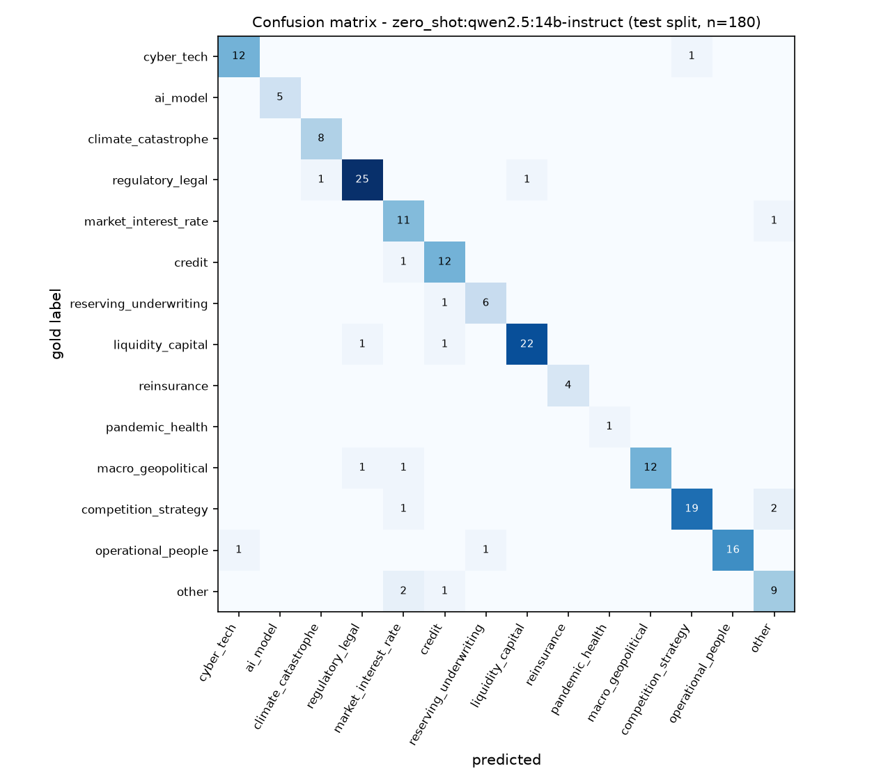
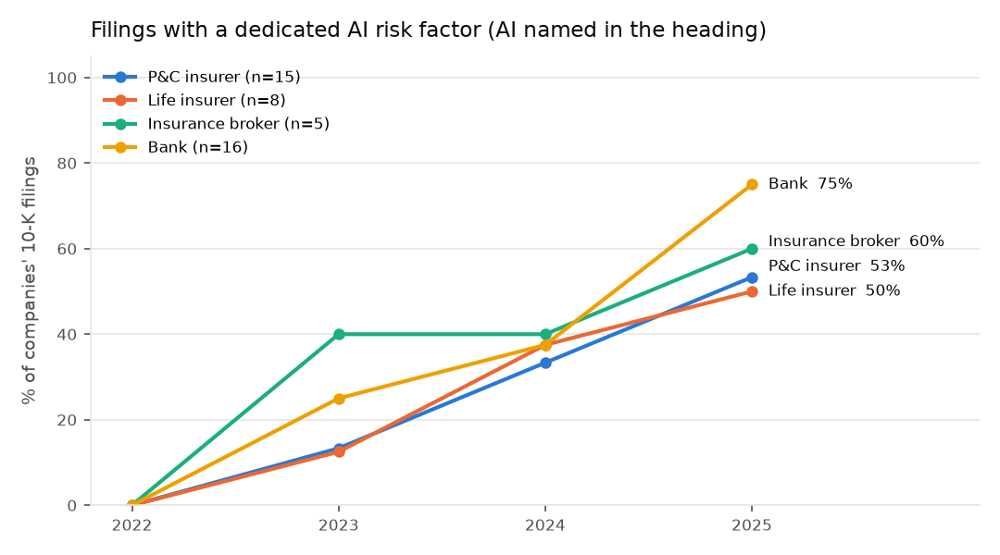
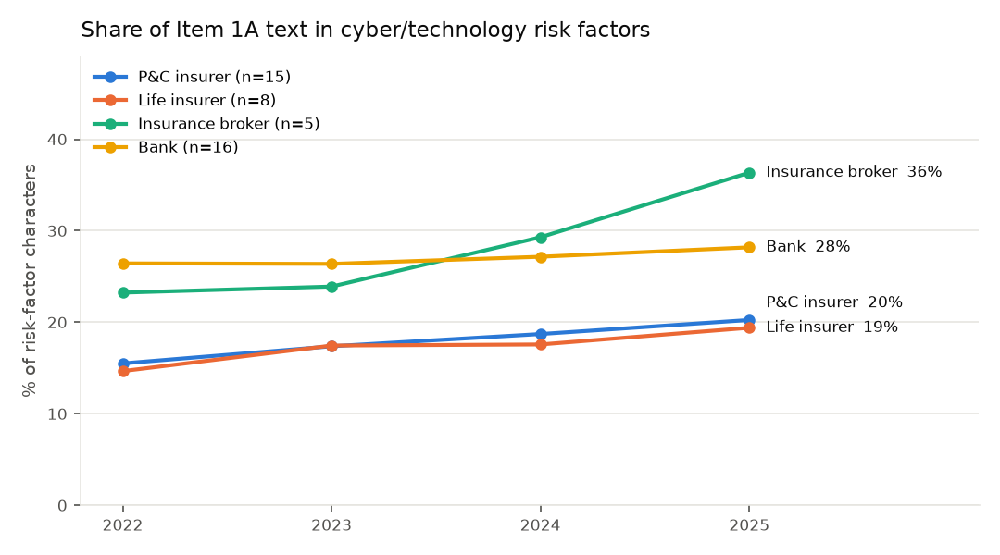
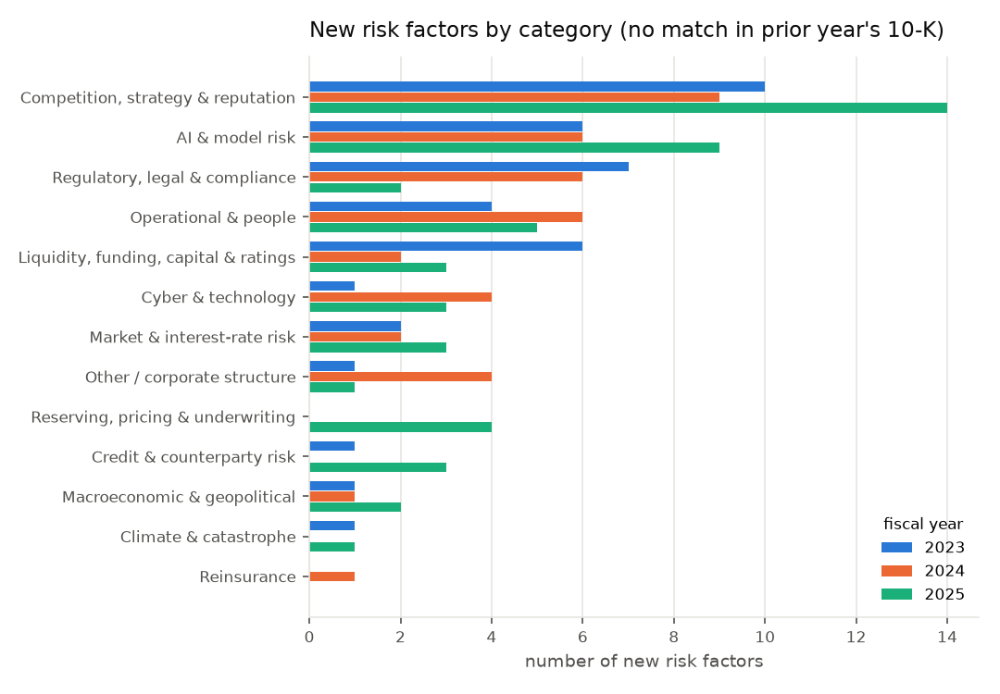
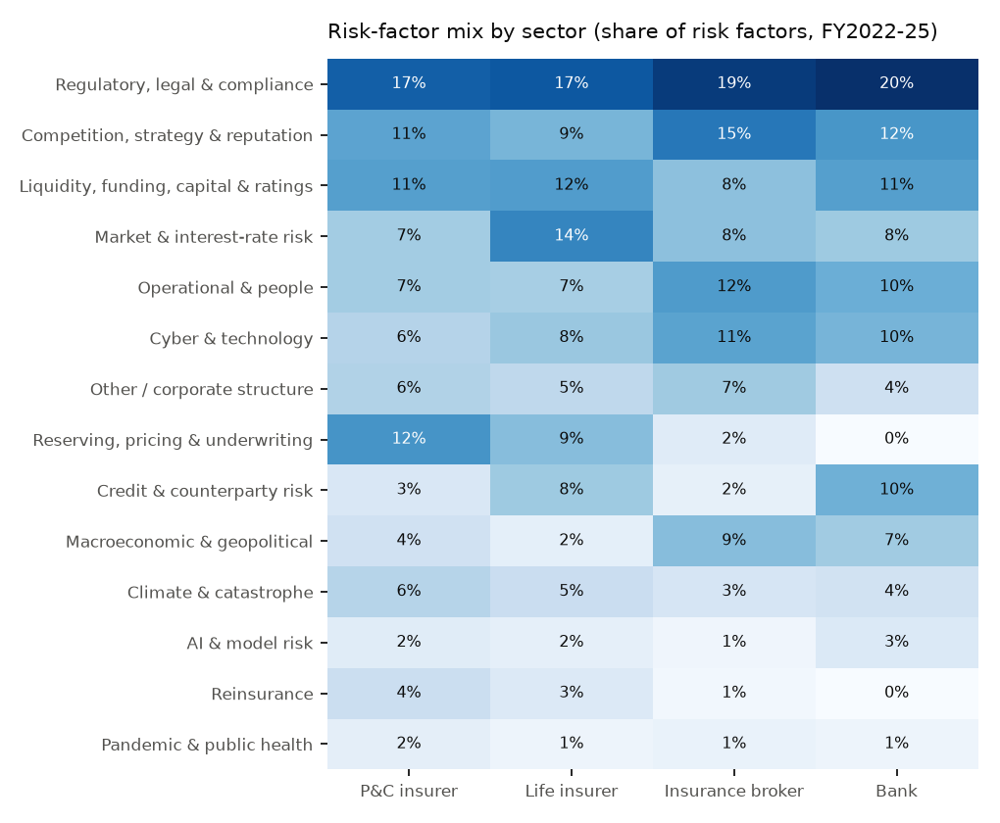
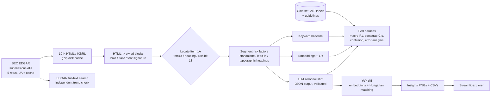

# 10-K Risk Radar

**An LLM pipeline that pulls 176 Form 10-K filings from SEC EDGAR, extracts and segments the
Item 1A risk factors of 44 US insurers, insurance brokers and banks (FY2022-FY2025), classifies
5,823 risk factors into a 14-class risk taxonomy, tracks year-over-year changes, and - the
centerpiece - measures how well it all works against a hand-labeled gold set.**

Real data, all public (SEC EDGAR, retrieved 2026-10-10). Local models only
(`qwen2.5:7b-instruct`, `qwen2.5:14b-instruct`, `nomic-embed-text` via Ollama) behind an
OpenAI-compatible client, so the same code runs against any hosted API.

## Results

### Classification quality (held-out test split, n = 180 hand-labeled risk factors)

| approach | accuracy | macro-F1 [95% bootstrap CI] | lenient acc.* | invalid JSON | mean latency / item** |
|---|---|---|---|---|---|
| keyword baseline | 0.72 | 0.75 [0.67, 0.80] | 0.82 | - | ~0 |
| nomic-embed-text + logistic regression (5-fold CV) | 0.80 | 0.75 [0.69, 0.85] | 0.88 | - | embedding only |
| qwen2.5 7B zero-shot | 0.80 | 0.81 [0.73, 0.86] | 0.87 | 0.0% | 1.0 s |
| qwen2.5 7B few-shot (14 examples) | 0.82 | 0.84 [0.76, 0.88] | 0.88 | 1.7% | 1.7 s |
| **qwen2.5 14B zero-shot** | **0.90** | **0.91 [0.86, 0.94]** | **0.96** | 0.6% | 2.1 s |
| qwen2.5 14B few-shot (14 examples) | 0.87 | 0.89 [0.83, 0.93] | 0.90 | 1.7% | 4.1 s |

\* prediction equals the gold primary *or* a gold secondary label. \*\* RTX 4080, 4 concurrent requests.
Source: [`data/results/eval_table_test.md`](data/results/eval_table_test.md), [`eval_summary_test.json`](data/results/eval_summary_test.json).

- **14B zero-shot beats every alternative**; paired bootstrap on the same items: +0.17 macro-F1 over
  keywords (95% CI [0.10, 0.23]), +0.10 over 7B zero-shot ([0.04, 0.18]).
- **Few-shot helped the 7B (+0.02) but not the 14B** (zero-shot minus few-shot = +0.02, CI [-0.03, +0.07], crosses zero) while
  doubling prompt tokens (1.9k -> 4.0k) - so the corpus is classified with 14B **zero-shot**.
- **Error analysis** (18 errors): 10 picked the gold *secondary* label, 3 were items flagged ambiguous
  while labeling, 5 plain misses. Biggest confusion: accounting-estimate risks ("other") vs market/credit.
  [`error_analysis_test.csv`](data/results/error_analysis_test.csv)
- **Severity scores are not trustworthy**: 7B vs 14B agreement on the 1-5 severity is quadratic-weighted
  kappa 0.18 (zero-shot) / 0.57 (few-shot), so severity is shown in the explorer but used in no conclusion.



### Extraction and segmentation

| check | result |
|---|---|
| Item 1A located | **176 / 176 filings** (160 standard "Item 1A", 8 annual-report-style heading [Citi, Morgan Stanley], 8 via Exhibit 13 [Wells Fargo, U.S. Bancorp]) |
| manual boundary spot-check (25 random sections) | 25 / 25 start and end correct ([`extraction_spotcheck.csv`](data/results/extraction_spotcheck.csv)) |
| risk factors segmented | 5,823 (median 32 per filing, min 16, max 58) |
| gold units that were real single risk factors | 240 / 240 (judged on heading + first ~1,200 chars) |
| YoY "new" precision (25 random "new" flags vs. nearest prior-year risk factor) | 21 / 25 truly new, 2 reworded, 2 uncertain ([`new_rf_precision_check.csv`](data/results/new_rf_precision_check.csv)) |

### What the data shows



- **Dedicated AI risk factors went from 0 of 44 companies (FY2022) to 9 (FY2023), 16 (FY2024) and
  27 (FY2025)** - a risk factor whose *heading* names AI / machine learning / generative AI. Banks lead
  (12 of 16 in FY2025). Mentions of AI anywhere in Item 1A: 15 -> 34 -> 44 -> 44 filings.
- **Independent cross-check with SEC full-text search** (whole filing, all exhibits): "artificial
  intelligence" in 19 -> 38 -> 43 -> 44 of the same 44 companies' 10-Ks; "generative AI" 0 -> 9 -> 21 -> 24.
  Every Item 1A mention found by this pipeline is also an EFTS hit (0 contradictions).
  [`fts_crosscheck.csv`](data/results/fts_crosscheck.csv)
- **Cyber/technology risk factors take a growing share of Item 1A text**: 20.2% (FY2022) -> 24.8% (FY2025)
  on average; brokers 23% -> 36%.



- **Year over year**, about 40-50 risk factors per year are new across the 44 companies and 47-100 are
  materially expanded; new ones cluster in competition/strategy (often M&A), AI, and regulation.



- Sector fingerprints are what an underwriter would expect: reserving/underwriting is 12% of P&C insurers'
  risk factors and ~0% of banks'; credit is 10% for banks; market/interest-rate risk peaks for life insurers (14%).



What I would **not** conclude: risk factors measure *disclosure* (shaped by lawyers, SEC comments and
peers), not exposure. More AI risk factors means firms feel obliged to talk about AI, not that AI losses
happened.

## How it works



Design notes (full reasoning in [`docs/INTERVIEW_GUIDE.md`](docs/INTERVIEW_GUIDE.md)):
- **EDGAR client** (`edgar.py`): refuses > 10 req/s or a User-Agent without contact info; retries 429/5xx;
  walks paginated submission files (big banks' 10-Ks hide behind thousands of 424B2 filings).
- **Item 1A location** (`extract.py`): scores every "Item 1A" candidate span and keeps the longest (the table
  of contents has the same text); falls back to a "RISK FACTORS" caption, then to Exhibit 13.
- **Segmentation** (`segment.py`): risk-factor headings are found from typography, not words; group captions
  ("Insurance-Related Risks") are kept as context; the Risk Factor Summary is skipped.
- **LLM** (`llm.py`, `classify/llm_classifier.py`): temperature 0, JSON mode, every output validated against
  the taxonomy (invalid outputs are counted and scored as wrong), sqlite response cache for reproducibility.
- **YoY diff** (`diff.py`): one-to-one matching on embedding cosine >= 0.80, then a word-level diff decides
  unchanged / modified / expanded.

## Run it (5 commands)

```bash
python -m venv .venv && . .venv/bin/activate          # Windows: .venv\Scripts\activate
pip install -r requirements.txt -r requirements-dev.txt && pip install -e . --no-deps
pytest -q                                              # 38 tests, LLM and EDGAR mocked
streamlit run app/streamlit_app.py                     # explorer over the committed results
riskradar run && riskradar eval --split test           # full rebuild: needs an OpenAI-compatible endpoint
```

The full rebuild expects an endpoint serving the models, e.g. `ollama pull qwen2.5:14b-instruct nomic-embed-text`,
then `RISKRADAR_LLM_BASE_URL=http://127.0.0.1:11434/v1 RISKRADAR_LLM_MODEL=qwen2.5:14b-instruct`.
Downloads ~93 MB (gzipped) from EDGAR once; classification of 5,823 risk factors took 39.5 min
(4,535 uncached calls, 1.9 items/s, RTX 4080).

| step | command | output |
|---|---|---|
| fetch | `riskradar fetch` | `data/cache/` (gitignored), `data/interim/filings.parquet` |
| extract | `riskradar extract` | `sections.parquet`; report: `python scripts/extraction_report.py` |
| segment | `riskradar segment` | `risk_factors.parquet` |
| classify | `riskradar classify --model qwen2.5:14b-instruct` | `classifications.parquet`, `data/results/classify_run.json` |
| diff | `riskradar diff` | `diffs.parquet` |
| insights | `riskradar insights` | `docs/*.png`, `data/results/insights_*.csv` |
| evaluate | `riskradar eval --split test` | `data/results/eval_*` |
| checks | `scripts/error_analysis.py`, `scripts/consistency.py`, `scripts/fts_crosscheck.py` | `data/results/` |

### Cost and latency
Local inference, so no API bill. Per risk factor the 14B zero-shot prompt averages 1,905 input + 73 output
tokens; ~33 risk factors per filing makes ~65k tokens and ~17 s of wall time per filing at 4-way
concurrency (11.5M tokens for the whole corpus). On a hosted API, cost = tokens x price; the 1.9k-token
system prompt is identical across calls, so prompt caching would remove most of it.

## Evaluation design

- **Gold set:** 240 risk factors, 60 per sector, randomly sampled (seeded) from the 5,823; 60 dev / 180 test.
  Labels follow [`docs/LABELING_GUIDELINES.md`](docs/LABELING_GUIDELINES.md) (primary = loss driver named in the
  heading, 14 ordered decision rules, worked examples) - [`data/gold/gold.csv`](data/gold/gold.csv).
- **Who labeled:** the labels were produced by an AI assistant (Claude) acting as annotator under those
  guidelines and have not yet been audited by a human. Claude is a different model family from the models
  evaluated, but treat the numbers as "agreement with a careful, documented annotator", not ground truth.
- **Consistency:** a blind, shuffled second pass on 50 random gold items agreed on 49 (Cohen's kappa 0.98).
  Same annotator, with near-duplicate texts across years - an optimistic upper bound, not inter-annotator
  agreement. [`consistency.json`](data/results/consistency.json)
- **No test-set tuning:** the prompt went v2 -> v3 (added decision rules) using the dev split only
  (14B few-shot dev macro-F1 0.837 -> 0.856), then was frozen and the test split scored once
  ([`prompt_iterations/`](data/results/prompt_iterations)). Few-shot examples come from outside the gold set.
- **Metrics:** macro-F1 (rare classes count equally), accuracy, Cohen's kappa, 1,000-sample bootstrap CIs,
  paired bootstrap for model comparisons.
- **CI:** GitHub Actions runs the unit tests (mocked LLM/EDGAR) and an offline smoke eval on the committed
  gold set and predictions.

## Data sources and licenses

| source | use | terms |
|---|---|---|
| SEC EDGAR submissions API, Archives, filing index pages, full-text search (efts) | 10-K filings | Public information; SEC fair-access policy followed (<= 10 req/s, declared User-Agent). Companies' filing text is quoted only in short excerpts (gold set, sample). |
| `qwen2.5:7b-instruct`, `qwen2.5:14b-instruct` (Alibaba Qwen) | classification | Apache 2.0 |
| `nomic-embed-text` (Nomic AI) | embeddings | Apache 2.0 |

Bulk filings and intermediate tables are not committed (`data/cache/`, `data/interim/` are gitignored).
Committed: the gold set, few-shot examples, all results, `data/sample/explorer.parquet` (headings + 400-char
excerpts + labels for the dashboard), and one full example filing's risk factors
(`data/sample/TRV_FY2024_risk_factors.csv`).

## Limitations

1. Gold labels come from a single AI annotator, unaudited; the consistency check is same-annotator.
2. 180 test items: rare classes (AI 5, pandemic 1, reinsurance 4 items) have very noisy per-class F1.
3. The universe is 44 hand-picked large filers, not a random sample; brokers are only 5 companies.
4. The taxonomy is my own; boundary classes (accounting estimates, capital vs regulation) drive most errors.
5. YoY threshold (0.80 cosine) was set by inspecting distributions; only precision of "new" was spot-checked.
6. The LLM's `ai_related` flag disagrees with explicit AI wording on 241 of 5,823 risk factors (125 flagged
   without AI wording - mostly generic model risk), so AI trends use deterministic wording rules instead.
7. Severity scores are unvalidated (low inter-model agreement).

## What I'd do next
- A human second annotator on 50+ items for real inter-annotator kappa; a targeted rare-class sample.
- JSON-schema constrained decoding (enum categories) and a hosted-model comparison at the same prompt.
- Label matched/unmatched pairs to tune the YoY threshold for precision *and* recall.
- Split "other" into an accounting & reporting class; multi-label evaluation.
- Scheduled refresh as new 10-Ks land, with alerts when a peer adds a new risk factor
  (deployment files in [`deploy/`](deploy), not deployed).

## Repository layout
```
src/riskradar/      edgar, html_blocks, extract, segment, taxonomy, llm, classify/, diff, evaluate,
                    eval_harness, insights, pipeline, cli
app/                Streamlit explorer          scripts/   gold sampling, reports, cross-checks
data/gold/          labels + guidelines inputs  data/results/  every number in this README
docs/               figures, INTERVIEW_GUIDE, LABELING_GUIDELINES, TAXONOMY
tests/              38 tests (fixtures are synthetic)      deploy/   Dockerfile + compose
```
